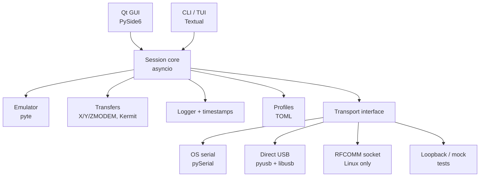

# Portside — Cross-Platform Serial Terminal (PRD)

2026-09-18 · @Someone

## Overview

Portside is an open-source, cross-platform (Linux, macOS, Windows) serial terminal written in Python, functionally inspired by Decisive Tactics' Serial for Mac. It lets engineers and admins connect to routers, switches, embedded boards and lab gear over USB-serial, native RS-232 or Bluetooth serial, with no driver hunting in the common case.

Portside reimplements the feature set only. It must not copy Serial's name, icon, UI artwork, text or code.

### Problem

- Free terminals (PuTTY, minicom, screen, CoolTerm) are either single-platform, dated, or weak on network-gear workflows like break signals and paced pasting.
- Adapter drivers are the top source of friction: missing drivers, fake chips, conflicting drivers, and permission errors.
- Teams with mixed OSes lack one tool with the same profiles and behaviour everywhere.

### Goals

1. One app with identical features and profile files on Linux, macOS and Windows.
2. Connect to a typical USB-serial adapter in under 30 seconds from first launch.
3. Reliable network-gear workflows: break, paced paste, logging, file transfer.
4. Clear, actionable diagnostics when a port can't be opened (permissions, busy port, bad driver).

### Non-goals (v1)

- SSH, Telnet or RDP client features (possible v2 via plugin).
- Kernel driver development or signed driver installers.
- Mobile platforms.
- Pixel-perfect clone of Serial's interface.

## Users and use cases

| User | Typical task | Must-have features |
| --- | --- | --- |
| Network / sysadmin | Console into Cisco, Juniper, firewalls; recover passwords | Break signal, paced paste of configs, session logs |
| Embedded / firmware dev | Read boot logs from ESP32, STM32, Raspberry Pi UART | Auto-reconnect on USB replug, timestamps, hex view |
| AV / lab technician | Control projectors, PLCs, instruments via RS-232 | Send-string macros with hex, profiles, scripting |
| Legacy server admin | Serial console on Sun, HP, IBM servers | VT100/xterm emulation, XMODEM/ZMODEM transfers |

Core flow: launch app → device list shows ports with friendly names (chip, vendor, serial number) → pick one → pick or auto-apply a profile → terminal opens connected.

## Platform compatibility

All features run on all three OSes through the OS's own serial drivers (pySerial). The optional "direct USB" backend (Serial's signature driverless mode) is best-effort and platform-dependent, as the table shows.

| Area | Linux | macOS | Windows |
| --- | --- | --- | --- |
| Supported versions | Ubuntu 22.04+, Debian 12+, Fedora 39+ (x86\_64, arm64) | macOS 12+ (Intel and Apple Silicon) | Windows 10 22H2+, Windows 11 (x64, arm64) |
| Port names | /dev/ttyUSB\*, /dev/ttyACM\*, /dev/ttyS\*, /dev/rfcomm\*; stable names via /dev/serial/by-id | /dev/cu.\* only (hide /dev/tty.\* by default, it blocks on DCD) | COM1–COM256, names above COM9 handled by pySerial |
| Built-in drivers | FTDI, CP210x, CH34x, PL2303, CDC-ACM in kernel | FTDI, CDC, CH34x, CP210x, PL2303 via Apple DriverKit on recent macOS | CDC via usbser.sys; FTDI/CP210x/PL2303 via Windows Update; CH34x often needs vendor driver |
| Permissions | User must be in dialout (Debian/Ubuntu) or uucp (Arch); app detects and shows the fix command | Usually none | None |
| Direct USB backend (pyusb + libusb) | Works; needs udev rule (app can generate one) and kernel driver detach | Works only if no DriverKit driver claims the device; warn otherwise | Needs WinUSB bound via Zadig; off by default, documented as advanced |
| Bluetooth SPP | Via /dev/rfcomm\* or AF\_BLUETOOTH RFCOMM socket | Paired SPP devices appear as /dev/cu.\*; use serial path | Paired SPP devices get an outgoing COM port; use serial path |
| Hot-plug detection | pyudev events, polling fallback | Polling of port list (1 s) | WM\_DEVICECHANGE or polling fallback |
| Break signal | Native | Native (some drivers lack it → emulated) | Native (some drivers lack it → emulated) |
| Packaging | AppImage + .deb, pip/pipx | Signed, notarized .app in .dmg (universal2) | Signed .msi or .exe installer, portable .zip |
| Config location | \~/.config/portside | \~/Library/Application Support/Portside | %APPDATA%\\Portside |

Rules that apply everywhere:

- Use `platformdirs` for all paths; never hard-code separators or home paths.
- Profiles and logs use UTF-8 and LF internally; line-ending translation is a per-profile setting, not an OS default.
- Every platform-specific code path lives behind one `platform/` module with the same interface on each OS.
- CI runs the full test suite on ubuntu-latest, macos-latest and windows-latest for every commit.

## Functional requirements

Priority: P0 = v1.0 must ship, P1 = v1.x, P2 = later.

| ID | Area | Requirement | Priority |
| --- | --- | --- | --- |
| F1 | Device discovery | List all serial ports with port name, description, VID:PID, chip family, serial number, driver in use; refresh on hot-plug within 2 s | P0 |
| F2 | Device discovery | Remember a device by VID:PID + serial number so the same adapter maps to the same profile across replugs and COM/tty renames | P0 |
| F3 | Connection | Baud 50 – 4,000,000 plus custom; data bits 5–8; parity N/E/O/M/S; stop 1/1.5/2; flow control none / RTS-CTS / DSR-DTR / XON-XOFF | P0 |
| F4 | Connection | Manual DTR/RTS toggles; live CTS/DSR/DCD/RI indicators | P0 |
| F5 | Connection | Auto-reconnect when the device disappears and returns, with visible status | P0 |
| F6 | Connection | Detect busy port / permission denied / driver conflict and show a platform-specific fix | P0 |
| F7 | Terminal | VT100/ANSI and xterm emulation (colors, cursor, alternate screen, line drawing), plus raw mode with no emulation | P0 |
| F8 | Terminal | Scrollback (default 10,000 lines, configurable), find, copy, select-to-copy option, font/size, dark and light themes | P0 |
| F9 | Terminal | Local echo, CR/LF/CRLF translation on send and receive, backspace sends BS or DEL | P0 |
| F10 | Terminal | Hex view and mixed hex/ASCII view; option to strip high bit | P1 |
| F11 | Terminal | Character sets: UTF-8, ASCII, Latin-1, CP437, CP850 | P1 |
| F12 | Network gear | Send break (duration configurable, default 250 ms); emulated break (drop to low baud, send 0x00, restore) when native break fails | P0 |
| F13 | Network gear | Text pacing on paste: per-character and per-line delay, optional wait-for-prompt regex | P0 |
| F14 | Network gear | Software XON/XOFF emulation when driver lacks it | P1 |
| F15 | Logging | Manual and automatic session logs, text or raw binary, path and filename template, size-based rotation | P0 |
| F16 | Logging | Timestamps per line: off, absolute, elapsed since connect (resettable), delta between lines | P0 |
| F17 | File transfer | XMODEM (checksum, CRC, 1K) and YMODEM send/receive with progress and cancel | P0 |
| F18 | File transfer | ZMODEM send/receive, including auto-start on ZRQINIT detection | P1 |
| F19 | File transfer | Kermit send/receive; raw binary send of a file; drag-and-drop to send | P1 |
| F20 | Profiles | Named profiles storing all port and terminal settings as TOML; auto-apply by device identity; import/export | P0 |
| F21 | Macros | Send-string buttons and hotkeys with escapes (\\r, \\n, \\xHH) and hex input | P1 |
| F22 | UI | Multiple sessions as tabs and separate windows; session status bar (port, baud, bytes in/out, signals) | P0 |
| F23 | CLI | `portside --list`, `portside connect <port> --baud 115200 --profile X` running a TUI in the terminal | P1 |
| F24 | Scripting | Python plugin/script API: open port, send, expect regex, log (for automation such as projector control) | P2 |
| F25 | Direct USB | Optional user-space drivers via pyusb for FTDI, CP210x, CH34x, PL2303 when no OS driver exists | P2 |

## Architecture and tech stack

A UI-independent core does all I/O, emulation and protocols; the Qt GUI and the Textual TUI are thin front ends over it.



The transport interface (open, close, read, write, set\_params, send\_break, set\_dtr/rts, get\_modem\_lines) is the only place OS or hardware differences leak in.

| Layer | Choice | Why |
| --- | --- | --- |
| Language | Python 3.11+ | Modern typing, asyncio TaskGroups, wide availability |
| Serial I/O | pySerial 3.5+ with a reader thread bridged to asyncio | Most mature cross-platform serial library; `loop://` and `socket://` URLs aid testing |
| Port discovery | `serial.tools.list_ports` + pyudev (Linux hot-plug) | Gives VID, PID, serial number, description on all OSes |
| Terminal emulation | pyte | Pure-Python VT100/xterm screen model, works in both front ends |
| GUI | PySide6 (Qt 6, LGPL) | Native look on all three OSes, good text rendering, official Qt binding |
| TUI | Textual | Same core usable over SSH or in headless labs |
| XMODEM/YMODEM | `xmodem` package, wrapped | Proven implementation; YMODEM batch added in-house if needed |
| ZMODEM / Kermit | In-house implementation; fallback to `sz`/`rz` from lrzsz if installed | No maintained pure-Python library exists |
| Direct USB | pyusb + libusb (bundled via `libusb-package`) | User-space chip drivers; pyftdi for FTDI |
| Config | TOML via tomllib (read) + tomli-w (write); paths via platformdirs | Human-editable profiles, OS-correct locations |
| Packaging | PyInstaller (or Briefcase) per OS, driven by GitHub Actions matrix | Produces .app/.dmg, .msi/.exe, AppImage/.deb |
| Quality | pytest, pytest-qt, hypothesis, ruff, mypy --strict | Fast feedback, typed core |

Proposed layout: `src/portside/{core,transport,emulation,transfer,profiles,logging,platform,gui,tui,cli}` with `tests/` mirroring it.

## Non-functional requirements, testing, packaging

| Area | Requirement |
| --- | --- |
| Throughput | Sustain 921,600 baud continuous receive with no dropped bytes and UI still responsive; 3 Mbaud on raw/hex view |
| Latency | Keystroke to wire under 10 ms; wire to screen under 50 ms |
| Startup | Cold start under 2 s on a 2020-era laptop |
| Memory | Under 200 MB with 4 sessions and 10,000-line scrollback each |
| Stability | No crash when a device is unplugged mid-transfer; session recovers or reports cleanly |
| Privacy | No telemetry, no network calls except an opt-in update check |
| Accessibility | Full keyboard navigation; screen-reader labels on all controls; high-contrast theme |
| i18n | UI strings externalized; English in v1 |
| License | MIT or Apache-2.0 for Portside; dependency licenses checked in CI (PySide6 is LGPL, keep dynamic linking) |

### Testing

- Unit: core, emulation, protocols against pySerial's `loop://` and a mock transport; property tests for XMODEM/ZMODEM framing and pacing.
- Integration: virtual serial pairs — socat on Linux and macOS, com0com on Windows — running a scripted fake device (echo, prompt, break detection, file receiver).
- Interop: transfers tested against lrzsz `sz`/`rz` and C-Kermit on Linux in CI.
- GUI: pytest-qt smoke tests on all three OSes (headless via offscreen platform).
- Hardware-in-the-loop (manual, per release): FTDI FT232R, CP2102, CH340, PL2303, a CDC-ACM board (Pico or Arduino), a Cisco USB console, one Bluetooth SPP module.

### Packaging and release

- GitHub Actions matrix builds all installers on tag; artifacts attached to the GitHub release.
- macOS: universal2 build, Developer ID signing and notarization.
- Windows: Authenticode-signed installer; winget manifest.
- Linux: AppImage, .deb, and `pipx install portside`; ship a sample udev rule.
- Settings and profile files are forward-compatible via a `schema_version` field and migrations.

## Milestones, risks, open questions

| Milestone | Scope | Exit criteria |
| --- | --- | --- |
| M1 Core | Transport interface, pySerial transport, discovery, session core, CLI list/connect in raw mode | Loopback and socat tests pass on all 3 OSes in CI |
| M2 Terminal | pyte emulation, Textual TUI, logging, timestamps, break + emulated break, paced paste | Can configure a real Cisco switch from the TUI on each OS |
| M3 GUI | PySide6 app: device list, tabs, settings, profiles, signals panel, themes | Usability pass: new user connects in under 30 s |
| M4 Transfers | XMODEM/YMODEM, then ZMODEM and Kermit | Interop tests vs lrzsz and C-Kermit green |
| M5 Release 1.0 | Signed installers for all OSes, docs, diagnostics wizard | Hardware-in-the-loop checklist passes |
| M6 Post-1.0 | Direct USB backend, scripting API, macros | Per-feature |

### Risks

| Risk | Mitigation |
| --- | --- |
| Python GUI can lag at high data rates | Batch reads, render at max 60 fps, keep I/O off the UI thread, raw mode bypasses emulation |
| Direct USB conflicts with OS drivers (DriverKit on macOS, WinUSB on Windows) | Ship it off by default, detect conflicts and explain; OS driver path is always primary |
| ZMODEM/Kermit are complex and underspecified | Implement against lrzsz/C-Kermit behaviour with interop tests; lrzsz fallback |
| Clone/counterfeit chips (fake FTDI, PL2303) misbehave | Known-bad list with warnings, as Serial does |
| Code-signing costs and notarization friction | Budget Apple and Windows certificates early; unsigned dev builds for testers |

### Open questions

- [ ] Is a GUI required in v1, or is TUI-first acceptable to ship sooner?
- [ ] Open-source license: MIT or Apache-2.0?
- [ ] Is the direct USB backend worth building at all, given modern OSes ship drivers for most chips?
- [ ] Do we need SSH/Telnet in the same app, or keep it strictly serial?

## Claude Code build prompt

Export this doc as markdown, save it as `docs/PRD.md` in an empty repo, then paste the prompt below into Claude Code. It builds milestone by milestone and stops for review between them.

```text
You are building "Portside", a cross-platform (Linux, macOS, Windows) serial terminal in Python.
The full product requirements are in docs/PRD.md. Read it completely before doing anything.

Hard constraints:
- Python 3.11+, src layout: src/portside/{core,transport,emulation,transfer,profiles,logging,platform,gui,tui,cli}.
- Must run identically on Linux, macOS and Windows. All OS-specific code lives only in
  src/portside/platform/ and src/portside/transport/, behind typed interfaces. No hard-coded
  paths or separators; use pathlib and platformdirs. On macOS list /dev/cu.* not /dev/tty.*.
- Core is UI-independent and asyncio-based. pySerial blocking reads run in a thread and are
  bridged to asyncio; the UI thread never touches the port.
- Stack: pySerial, pyte, PySide6 (GUI), Textual (TUI), platformdirs, tomllib/tomli-w,
  xmodem, pyudev (Linux only, optional import). Dev: pytest, pytest-asyncio, pytest-qt,
  hypothesis, ruff, mypy --strict. Manage with uv and pyproject.toml.
- Do not copy any name, text, icon or code from Decisive Tactics' "Serial" app. Original work only.

Workflow:
1. First, write docs/PLAN.md: break milestone M1 from the PRD into small tasks, each with the
   PRD requirement IDs (F1, F3, ...) it satisfies and how it will be tested. Show me the plan
   and wait for my approval.
2. Then implement M1 only: Transport ABC, PySerialTransport, LoopbackTransport for tests,
   port discovery with VID/PID/serial number, the session core, and a CLI:
   `portside --list` and `portside connect <port> --baud N` (raw pass-through mode).
3. Write tests first where practical. Use pySerial's loop:// URL and a mock transport for unit
   tests; add an integration test that uses a socat virtual pair when socat is available
   (skip cleanly on Windows or when missing).
4. Add .github/workflows/ci.yml running ruff, mypy and pytest on ubuntu-latest,
   macos-latest and windows-latest with Python 3.11 and 3.13.
5. Handle errors per requirement F6: permission denied (tell Linux users the exact
   `sudo usermod -aG dialout $USER` fix), port busy, and device vanished — as typed exceptions
   the UI can display.
6. When M1 is done, run the full test suite and linters, fix failures, update README.md with
   install/run instructions for all three OSes, commit with a clear message, summarise what is
   done vs. the PRD, and STOP. Do not start M2 until I say so.

For each later milestone I will say "continue with M2" (etc.). Follow the same loop: plan,
wait for approval, implement with tests, green CI on all three OSes, summarise, stop.

When something in the PRD is ambiguous, choose the simplest option that keeps cross-platform
behaviour identical, note the decision in docs/DECISIONS.md, and continue.
```

Tips: run Claude Code from the repo root; keep each milestone in its own branch; if you only have one OS locally, rely on the CI matrix to catch Windows and macOS issues.
